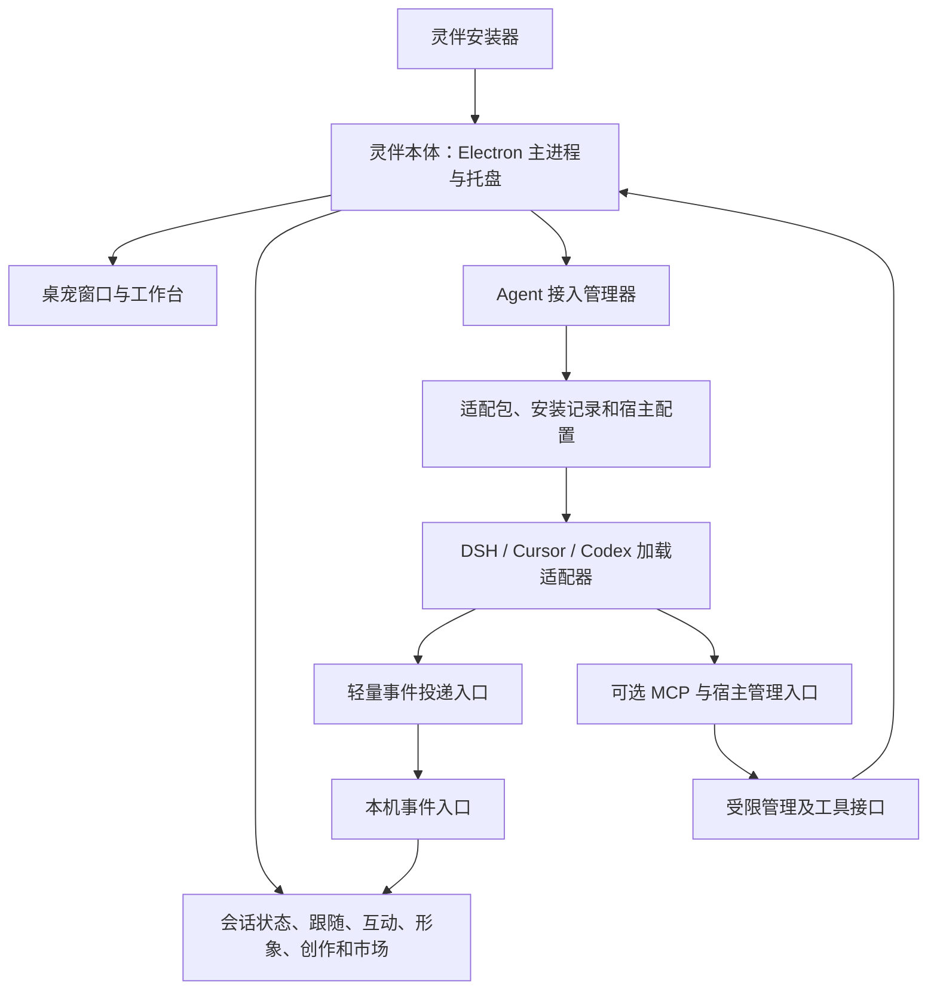

# 灵伴本体优先架构设计

状态：0.7.0 首阶段已实现，当前实现与迁移边界见 [独立本体安装](desktop-installation.md)。本文保留完整目标设计；自动迁移全部旧宿主、独立在线适配包发行等目标尚未全部实现。适用范围：Windows 本机；DSH、Cursor、Codex 接入。

## 1. 产品决策

所有用户先安装灵伴本体。本体提供桌宠、工作台、形象库、互动、创作、市场、应用维护和 Agent 接入管理。用户在本体的「Agent 接入」中安装需要的插件，之后在原来的 Agent 应用中正常工作。

插件成为本体的适配器，只采集宿主事件和提供可选的宿主内管理、创作工具入口，不再携带本体、素材、Electron 下载器或本体更新逻辑。用户无需安装系统 Node.js 来运行灵伴提供的 Hook 或 MCP 入口；宿主本身的运行环境要求仍由宿主决定。

本次不新增纯陪伴模式，不修改现有全局、来源、固定会话三种跟随规则。未安装插件不阻止打开本体和桌宠；接入页如实显示尚未连接的状态，不强制用户完成向导。

## 2. 从当前架构到目标架构

当前依赖关系：宿主插件 → 准备共享运行时 → 下载或查找 Electron → 启动桌宠。本体代码和素材进入多个宿主发布包，各包有能力参与共享运行时版本选择。

目标依赖关系：安装器 → 本体 → 安装并管理轻量插件 → 宿主加载插件 → 事件进入本体。



本体是唯一的运行与版本管理者。适配器可以请求本体执行受支持操作，不能自行安装、替换、升级或回退本体。

## 3. 本体的内部边界

| 模块 | 职责 | 对现有代码的处理 |
| --- | --- | --- |
| 应用生命周期 | 单实例、托盘、窗口、开机启动、显式启动与退出 | 保留 desktop/main.js，拆分 desktop-runtime.js 的编排 |
| 领域服务 | StateStore、跟随、多桌宠、互动、形象库、创作与市场 | 复用现有实现，去掉对宿主启动方式的依赖 |
| 事件接入服务 | 来源登记、认证、会话归一化、序号、心跳和断线 | 复用 observer、protocol 和 state-store，集中生命周期 |
| 接入管理器 | 宿主发现、安装计划、安装、检查、修复、升级与卸载 | 从现有各宿主安装脚本提取统一接口 |
| 应用维护 | 本体包校验、安装、重启、健康检查、回退和诊断 | 收回 bootstrap/shared-runtime 中插件拥有的权限 |
| 展示层 | 桌宠、工作台、接入页和诊断页 | 通过受限 IPC 调用服务，不能直接执行安装命令 |

首版不增加常驻 Windows 服务。本体 Electron 主进程同时承载本机接入服务，桌宠和工作台窗口可独立关闭或隐藏。接入管理器只在安装、检查或修复时启动短期子进程。

现有每来源独立桥接进程逐步合并到本体；DSH 的长连接和短命 Hook 都接到统一入口。MCP stdio 进程因宿主协议需要继续独立，但只做协议转发，不维护第二份桌宠状态。

## 4. 安装布局与执行入口

默认每用户安装，无需管理员权限。下列为目标布局，不代表当前目录已经迁移：

```text
%LOCALAPPDATA%/Programs/LingPet/
  LingPet.exe                 稳定的桌面启动入口
  LingPetBridge.exe           稳定的 Hook / MCP 命令入口
  active.json                当前本体版本及上一版
  versions/<version>/        Electron、私有 Node、程序和内置素材

<安装目录>/data/               新安装默认位置，可在软件中迁移
  settings.json              保留现有桌宠配置与身份
  integrations/
    registry.json            接入记录与期望配置
    packages/<id>/<version>/  不可变轻量适配包
    transactions/<id>/       安装日志、配置备份和恢复记录
    connections/             本次运行的接入描述
  ...                        现有形象、项目与市场数据
```

0.7.1 新安装默认将数据保存到安装目录下的 data，安装时仅选择程序位置。旧版升级沿用 BoardAiPet 数据目录以降低迁移风险。在「应用设置 → 常规 → 数据与内容目录」可迁移到其他磁盘：复制现有数据、保留备份、切换目录联接并重启，使宿主注册与已有素材的访问路径保持有效。卸载只删除版本程序和稳定入口，保留内容与备份。宿主可能要求将插件复制到其管理目录，registry 记录实际安装路径；不假设宿主能够直接加载本体的包缓存。

安装包内携带 Electron 和独立的私有 Node 运行环境。Electron 用于桌面，私有 Node 用于短命 Hook、MCP 和命令入口，不使用系统 PATH，也不通过 ELECTRON_RUN_AS_NODE 实现 Hook。代价是增加安装体积，但避免宿主要求用户另装 Node 和 Electron 打包安全选项之间的耦合。

两个稳定入口负责解析当前有效版本，不包含业务逻辑。Bridge 只接受固定子命令、来源和安装实例标识，例如 hook、mcp、open-dashboard；不接受任意脚本路径或任意 Shell。稳定入口本身的更新走安装维护流程，在占用时延迟替换。

Hook 内不得包含版本目录路径；适配包仍需声明自己支持的 Bridge 协议范围。稳定路径不等于可以绕过宿主信任审核，命令、定义或相关内容变化时仍以宿主要求为准。

## 5. Agent 接入管理

工作台新增一级入口「Agent 接入」，按宿主与具体安装实例展示。DSH 的 web/desktop profile、多个 Codex 配置目录、Cursor 的用户与项目配置范围不能混成一条记录。

每个接入项提供：安装或接入、检查、打开宿主完成剩余步骤、修复、升级、停用和卸载。停用先在本体撤销该接入的事件权限；宿主注册清理或禁用失败时单独报告，不谎报宿主已停用。

### 5.1 统一安装接口

每个内置宿主适配器实现以下能力，安装器不靠拼接一段通用 Shell 处理所有宿主：

```text
discover()                     发现可识别的宿主、配置范围和能力
inspect(target)                读取实际注册、版本及冲突
planInstall(target, package)   生成确定的配置差异和剩余宿主步骤
apply(plan)                    应用安装，记录事务
verify(target)                 验证文件与注册；不伪造真实事件
repair(target)                 根据实际状态生成新的修复计划
planRemove(target) / apply()   仅移除灵伴拥有的配置与文件
```

宿主内置安装命令/API 优先；仅在已验证支持的版本中使用配置合并。CLI 不在 PATH 时允许选择宿主或配置位置，不要求用户为安装而另行配置终端。无法可靠自动化的步骤直接标明需在宿主完成，不能将文件复制成功视为全部完成。

所有写入先做所有权校验和备份；同一目标串行执行，应用前重新校验读取时的摘要。多文件安装使用事务日志，逐项记录结果；失败恢复仅修改仍与本次写入一致的字段，保留用户或宿主并发修改。宿主命令不可回滚时保留部分完成状态并提供修复或清理，不声称跨应用原子事务。

### 5.2 各宿主的目标包

| 来源 | 目标形态 | 安装管理的边界 |
| --- | --- | --- |
| DSH | 只保留宿主事件监听和必要的工具代理 | 按用户选择的 profile 注册；不再启动或发布共享本体 |
| Cursor | 轻量 Hooks；可选侧边栏 VSIX | 区分事件接入与侧边栏组件，避免插件和用户级 Hook 重复注册 |
| Codex | 轻量插件，含 Hooks 与可选 MCP/Skill | 本体负责准备和注册；宿主启用、Hooks 信任及重启按实际能力提示 |

首发在安装包中携带三类适配包，接入包准备过程可以离线；宿主自身的安装依赖或审核仍可能需要网络。后续可独立发布适配包；下载包必须验证受信任发布清单及摘要，摘要本身不能替代发布来源认证。接入包不能把下载清单变成任意命令执行入口。

Codex 默认选一种事件注册方式。当前用户级 Hook 作为明确记录的兼容方案，不能与插件 Hooks 同时发送同一批事件。不同宿主版本支持哪些安装、启用、审核接口，必须在实施时按实际版本验证，本方案不将现有接口假定为永久可用。

### 5.3 状态模型

不使用一个 installed 布尔值覆盖全部状态。每条记录至少独立保存：

| 维度 | 示例 |
| --- | --- |
| 宿主 | 未发现、已发现、版本不兼容 |
| 包与注册 | 未安装、安装中、已安装、部分失败、待升级 |
| 宿主动作 | 需启用、需信任、需重启、无需额外动作、无法判定 |
| 连接 | 未连接、管理通道在线、事件通道在线、已断开 |
| 事件验证 | 尚未收到真实事件、已收到及时间 |

界面据此给出具体下一步，例如“已安装，请在 Codex 审核 Hooks”，或“管理入口可用，等待真实会话事件”。多个维度可以同时成立。只有收到真实事件才标记事件接入已验证；诊断探测与动作试映不能更改该结论。

## 6. 事件和管理协议

本体保留仅绑定 127.0.0.1 的本机服务，端点随运行生成，描述文件原子写入。端口不写死。renderer 通过受限 preload IPC 管理接入，不直接拿到安装权限或接入凭证。

事件通道与管理通道必须分权：

- Hook/事件适配器只能注册和投递所属接入实例的事件、心跳及断开，不能安装包、更新本体或退出应用。
- 宿主内管理入口仅具备声明的显示桌宠、打开工作台等权限；创作工具按既有工具能力单独授权。
- 安装、卸载和本体维护仅从本体受校验的 IPC 或本地维护入口发起，不沿用一个 token 可调用所有路由的结构。

凭证绑定 installationId、source 和权限；本体校验事件声明与授权一致。凭证及描述文件受当前用户 ACL 保护，拒绝浏览器 Origin，不记录令牌。此机制防止误用和跨接入串线，不声称隔离同一 Windows 用户下的恶意进程。

协议握手独立协商 apiVersion、eventSchemaVersion、adapterVersion、coreVersion 和 capabilities。事件至少包含 installationId、source、scopeId、sessionId、eventId、sequence、连接代次及既有回合标识，沿用白名单元数据，不发送会话正文、工具参数或输出。

复用已有并行工具、回合结束和去重逻辑；断线后以带代次的状态快照恢复，旧代次和旧回合事件不得覆盖新状态，不重放庆祝。本体重启后，在收到新心跳/快照前将旧来源视为未验证在线，不能仅从磁盘记录恢复“已连接”。

## 7. 生命周期与失败处理

| 操作或故障 | 目标行为 |
| --- | --- |
| 启动本体 | 启动托盘、事件服务和已启用桌宠；恢复接入记录，不自动修改宿主配置 |
| 关闭工作台 | 本体和事件服务继续运行 |
| 隐藏或关闭桌宠展示 | 按现有显示/启用语义处理，接入和本体仍运行 |
| 托盘退出本体 | 关闭接入服务；后续 Hook 不得重新拉起本体 |
| 宿主内用户明确点击打开灵伴 | 经固定命令启动本体，再执行受支持操作 |
| 本体未运行 | Hook 快速返回宿主规定的中性成功结果，避免影响 Agent 工作 |
| 本体不可达或协议不兼容 | 受限超时，不阻塞模型流程；本体下次打开时给出可诊断状态 |
| 某个插件卸载或崩溃 | 只影响对应接入，不关闭本体、不移除桌宠或其他接入 |

不在每次 Hook 中启动桥接守护进程、下载文件或安装运行时。Hook 总预算应明显小于宿主限制，实施时通过真实 CMD/宿主进程测量启动与投递耗时；中性返回格式按各宿主分别实现，不统一硬编码为同一个 JSON。

首版不持久积压本体退出期间的事件。本体恢复后通过新事件或长连接快照恢复当前状态，不播放过期会话动作。

## 8. 本体、适配包和形象的版本管理

三个版本空间独立：本体版本、适配包版本、形象版本。适配包声明本体协议范围和宿主支持范围，本体升级先检查已安装接入的兼容性。更新本体不自动改写所有宿主配置，也不宣称宿主热加载了新插件。

本体维护流程：准备不可变新版本 → 验证发布来源与内容 → 兼容性检查 → 暂停切换 → 新进程健康检查 → 确认当前版本；失败恢复上一版。配置迁移需可回退，或保留对应旧版配置备份，不能仅回退程序后读取已不兼容的数据。

升级适配包先保留旧包和注册记录，再更新目标；需要宿主重新加载或审核时显示待完成。只有确认宿主已使用新版后，才清理旧包。形象继续独立导入/升级，不参与宿主接入版本选择。

原 shared/active.json 的“由任一插件提交本体候选版本”机制退出正常路径。新插件不得调用 prepareSharedRuntime、runtimeExecutable 或 /runtime/update。遗留协议可由迁移层临时识别，但不得赋予旧插件本体升级权限。

## 9. 旧安装迁移

迁移不能仅靠“新本体版本更高”：旧插件仍有启动旧进程和写共享指针的能力，必须处理旧注册和运行中实例。

1. 检查原 settings、形象、shared 目录、启动项、DSH profile、Cursor 插件/扩展、Codex 插件/用户 Hooks 和已运行桥接。
2. 生成逐目标迁移记录并备份，保留桌宠 ID、形象、位置、跟随规则和创作数据。
3. 安装本体和稳定入口，验证本体可运行；期间暂停旧自动唤起来源，避免双实例。
4. 对可识别的旧接入进行替换：移除其重复 Hook，将注册改为轻量适配器。保留其他插件、用户 Hook 和宿主信任记录；新命令的审核由宿主完成。
5. 停止可确认属于灵伴的旧桥接，更新属于本产品的开机启动项。宿主尚未重载时明确标注待重启；不能只更新磁盘就认为旧代码已退出。
6. 验证每个来源收到真实事件，再标记该来源迁移完成。无法自动处理的宿主留在待处理状态，不提前清理其依赖目录。
7. 所有引用和进程解除后，才将旧 shared 缓存列为可清理项；首轮迁移默认保留恢复材料。

过渡期检测到旧插件尝试发布本体时，本体拒绝旧更新入口并显示具体迁移项。由于旧插件可以另起进程，拒绝入口不是完整解决办法：未经替换/停用的旧接入不计为迁移成功，也不保证其能与新本体安全共存。不得通过修改其他宿主设置来掩盖冲突。

## 10. 卸载边界

卸载单个接入：撤销凭证，移除属于灵伴的注册、插件和可选宿主入口，保留其他接入、本体、桌宠及形象。若宿主必须重启才能卸载已加载组件，应显示剩余步骤。

卸载本体：先解除已管理宿主接入、撤销凭证和开机启动，再停止进程、删除程序。某个宿主清理失败时记录准确目标和恢复方式，不能显示全部清理完成；不能留下会因缺失执行入口而使 Agent 请求失败的活跃 Hook。用户数据默认保留，清除数据必须是明确选项。

安装器需要在主程序退出后继续执行维护，可使用同产品维护入口。卸载不依赖已删除的程序目录，也不能要求用户先恢复系统 Node 才能移除插件。

## 11. 建议代码组织

渐进拆分，不要求第一步改成多仓库：

```text
desktop/                       桌宠、工作台与接入页
src/app/                       生命周期、主进程编排、受限 IPC
src/core/                      桌宠、会话、跟随等领域服务
src/integrations/              接入管理、安装事务、记录与诊断
src/integrations/hosts/        dsh、cursor、codex 安装策略
src/transport/                 事件入口、认证、版本协商
src/maintenance/               本体更新、迁移、卸载
adapters/<host>/               轻量宿主清单、Hook 和工具代理
launcher/                      稳定应用与 Bridge 入口
scripts/build-desktop.*         独立安装包构建
scripts/build-adapters.*        轻量适配包构建
```

现有 observer/state-store/follow-resolver/pet-registry 优先复用；先通过接口分离依赖，再按改动需要移动文件，避免为了目录整齐大范围重写。

## 12. 实施顺序与验收

1. 确定本体生命周期、接入协议和兼容清单；提取现有启动依赖，保证本体不再执行插件版共享发布流程。
2. 完成带运行环境的 Windows 安装器、稳定入口、升级/回退及卸载；在无系统 Node、无 Agent 的干净环境验证。
3. 建立接入管理服务、安装事务和接入页；以三个宿主的真实安装目标验证发现、配置合并和并发冲突处理。
4. 逐个发布轻量 DSH/Cursor/Codex 包；包含事件、可选管理入口和创作工具的功能对等检查，避免瘦身时丢掉既有能力。
5. 完成旧安装迁移，再切换官网下载和接入说明为“先装本体”。旧完整插件包标记为历史发布，不再作为新用户入口。

上线必须验证：

- 干净 Windows 安装本体后，无系统 Node 也能打开桌宠、工作台并使用已安装宿主的 Hook/MCP 入口；离线可展示内置形象。
- 三个接入能从本体发起安装，准确区分注册、启用、信任、重载和真实事件；宿主不支持自动化时步骤明确。
- 多窗口、多 profile、多配置范围互不串线，同一事件不因双重 Hook 注册而重复。
- 退出本体后持续触发宿主事件，不会复活桌宠或拖慢/阻断 Agent。
- 本体重启、断线和升级后恢复当前状态，不播放历史完成动作；不兼容适配器有明确诊断。
- 安装中断、配置并发修改、适配包更新失败、本体健康检查失败都有可验证的恢复结果。
- 单接入卸载不影响其他接入；本体卸载不破坏用户自定义 Hooks；从旧三宿主完整包迁移后只有一套运行中的本体。

当前使用 Windows .NET Framework 构建稳定启动入口与自解压安装程序，宿主适配包在本体中按目标生成。发行签名和在线发布基础设施仍需后续配置；完整验收以实际测试记录为准。
